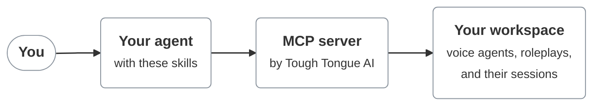

# Tough Tongue AI Skills

[](https://registry.modelcontextprotocol.io/v0.1/servers?search=com.toughtongueai/mcp)

Give your AI agent a [Tough Tongue AI](https://app.toughtongueai.com)
workspace. Build voice agents that call, demo, screen, and book. Build
roleplays that get you ready for negotiations, interviews, and coaching
conversations. Then improve both from what happened on real calls.

Works in ChatGPT, Claude, Claude Code, Cursor, Codex, Copilot, and VS Code.


https://github.com/user-attachments/assets/b7d2feff-b6aa-49e0-8ebc-066cf7090dc8


[](https://youtu.be/-8lZP3t1JIU)

<!-- Native player: open this file in GitHub's web editor and drop the .mp4
     on the line below the cover; GitHub inserts a URL that renders inline. -->

## Install

**ChatGPT or Claude (fastest):** install the official Tough Tongue AI plugin
from the [MCP page](https://app.toughtongueai.com/docs/mcp). One click, sign in
once, no terminal.

**Coding agents:** one command sets up every one on your machine (Claude Code,
Cursor, Codex, Copilot CLI, VS Code):

```bash
npx plugins add tough-tongue/toughtongue-skills
```

Restart your agent. The first Tough Tongue AI action opens a browser sign-in;
approve it once. No API key needed.

<details>
<summary>claude.ai and Claude Desktop, latest version</summary>

The official plugin can run behind this repo while a new version is in
review (see [FAQ](#faq)). To connect to the live server directly: Settings >
Connectors > Add custom connector, name it `Tough Tongue AI`, paste
`https://api.toughtongueai.com/api/public/mcp`, and approve the sign-in.

</details>

<details>
<summary>ChatGPT, latest version</summary>

Business, Enterprise, and Edu workspaces can publish their own copy of the
app from the live server instead of waiting on the directory. Steps:
[clients.md](skills/ttai-agent/references/mcp/clients.md#web-connectors).

</details>

<details>
<summary>Claude Code</summary>

```text
/plugin marketplace add tough-tongue/toughtongue-skills
/plugin install toughtongue@toughtongue-skills
```

Skills are namespaced: `/toughtongue:ttai-agent`. Re-authenticate anytime
with `/mcp`.

</details>

<details>
<summary>Codex</summary>

```bash
codex plugin marketplace add tough-tongue/toughtongue-skills
codex plugin add toughtongue@toughtongue
```

Restart, start a new thread, and log in when prompted (or
`codex mcp login ttai`).

</details>

<details>
<summary>Cursor</summary>

Settings > Plugins > Team Marketplaces > Add Marketplace > Import from Repo,
enter `https://github.com/tough-tongue/toughtongue-skills`, then install
**toughtongue**.

</details>

<details>
<summary>Windsurf, Gemini CLI, and other coding agents</summary>

```bash
npx skills add tough-tongue/toughtongue-skills
```

Then add a remote (HTTP) MCP server with the URL
`https://api.toughtongueai.com/api/public/mcp`. Config snippets per client:
[clients.md](skills/ttai-agent/references/mcp/clients.md).

</details>

## Say this first

```text
Get me started with Tough Tongue AI.
```

Your agent checks the connection, looks at what is in your workspace, and
suggests a first step.

## Prompts to copy

Each one is a complete request. Change the names and numbers to yours.

### Build a voice agent that takes the call

```text
Create a voice agent that calls new inbound leads, qualifies them on budget, timeline, and team size, and books a meeting with a rep when they fit. Then call my phone so I can test it.
```

```text
Build a screening agent for our SDR opening: a 10-minute call that checks quota history and cold-calling experience, scores each candidate against a rubric, and tells me who to move forward.
```

```text
Create a demo agent for our analytics dashboard. Here is a recording of me clicking through it: [paste]. Make the clicks deterministic so it never improvises.
```

```text
Send a meeting bot to my 3pm customer call to take notes and flag the open questions.
```

### Practice a conversation you have to nail

```text
Pull the last 3 calls from Gong where we lost on pricing. Create a scenario to practice that objection, using our positioning doc from Notion, and give me the practice link.
```

```text
I meet Sarah Chen from Acme in 30 minutes. Create a quick practice scenario from her LinkedIn and the company site.
```

```text
Create a behavioral interview roleplay for a senior PM role. The interviewer should push back on vague answers and score me on structure and impact.
```

```text
Create a salary negotiation roleplay where the AI plays a hiring manager with a fixed budget and a deadline.
```

### Improve from real calls

```text
For the Enterprise Discovery Call scenario, pull the last 50 sessions. What are the top 5 improvement areas? Give me a 3-slide deck.
```

```text
Find what went wrong in the 5 lowest-scoring onboarding sessions and fix the scenario.
```

```text
Here is yesterday's discovery call transcript: [paste]. Score it against our Discovery Call scenario and write the rep a coaching report.
```

```text
Every time a call ends in Gong, score the transcript and email the rep a coaching report.
```

### Give the agent a screen

```text
Build a checklist app that the onboarding agent ticks off during the call, and attach it to the scenario.
```

Prompts that mention Gong, Notion, a calendar, slides, or email use those
tools' own MCP servers alongside this one.

## How it works



Four skills tell your agent how to do the work. The hosted MCP server (15
tools) lets it act in your personal or organization workspace. The plugin
installs both.

- [ttai-agent](skills/ttai-agent): create, edit, and refine Scenarios;
  workspaces, phone calls, meeting bots, and sharing.
- [ttai-session-analyst](skills/ttai-session-analyst): turn session scores and
  transcripts into team and coaching reports; score outside calls.
- [ttai-browser-demo-builder](skills/ttai-browser-demo-builder): script exact
  browser steps for product demos from a recording or a walkthrough.
- [ttai-agent-apps](skills/ttai-agent-apps): build Agent Desktop apps, such as
  a board or checklist the voice agent updates during a call.

Your agent picks the right skill on its own.

<details>
<summary>Update</summary>

**Claude Code**

```bash
claude plugin marketplace update toughtongue-skills
claude plugin update toughtongue@toughtongue-skills
```

**Codex**

```bash
codex plugin marketplace upgrade toughtongue
codex plugin add toughtongue@toughtongue
```

`npx plugins add` and Cursor's import always install the latest version.

</details>

## FAQ

<details>
<summary>Which install should I pick?</summary>

Work in ChatGPT or Claude chat: the official plugin. Work in Claude Code,
Cursor, or Codex: the coding-agent plugin. Both can be connected at the same
time; they talk to the same workspace.

</details>

<details>
<summary>The ChatGPT or Claude plugin is missing something this repo has. Why?</summary>

Each new version of a directory plugin goes through OpenAI's or Anthropic's
review before it goes live, so the listed plugin can run weeks behind this
repo. The coding-agent plugin and a custom connector pull from this repo and
the live server, so they are always current. The directory build also
schedules meeting bots but does not place outbound phone calls; use a custom
connector or a coding agent for calls.

</details>

<details>
<summary>Do I need an API key?</summary>

No. Every interactive client signs in through the browser once. A personal
access token is only for headless use such as CI (see below).

</details>

<details>
<summary>Sign-in or 401 errors</summary>

Finish the browser sign-in. Claude Code: `/mcp`. Codex:
`codex mcp login ttai`. Cursor: Settings > MCP.

</details>

<details>
<summary>A Tough Tongue AI tool is missing</summary>

Start a new chat; if it persists, remove and re-add the MCP server.

</details>

<details>
<summary>The agent explains but can't act</summary>

The skills are installed but the MCP server is not. Add it for your client
([clients.md](skills/ttai-agent/references/mcp/clients.md)).

</details>

<details>
<summary>A Scenario change doesn't show in a running call</summary>

Edits apply to new sessions.

</details>

<details>
<summary>Reinstall the plugin (Claude Code)</summary>

`/plugin marketplace remove toughtongue-skills`, then add the marketplace and
install again.

</details>

<details>
<summary>Headless, CI, pinning, and repo layout</summary>

**No browser (CI, servers)**: create a personal access token at
[app.toughtongueai.com/developer](https://app.toughtongueai.com/developer),
export it as `TTAI_PAT`, and register the server with a bearer header that
names the variable. Per-client config:
[clients.md](skills/ttai-agent/references/mcp/clients.md). Never paste the
token into config files or chat.

**Pin a version**:
`claude plugin marketplace add tough-tongue/toughtongue-skills@<tag>`, or
clone at a commit and run `claude --plugin-dir <checkout>`. The hosted MCP
server is not versioned by this repo.

**One skill only**:
`npx skills add tough-tongue/toughtongue-skills --skill ttai-agent`. Skills
alone let the agent advise; the MCP server lets it act.

```text
toughtongue-skills/
├── plugin.json, mcp.json    # Agent Plugins manifest + MCP config (no credentials)
├── .claude-plugin/ .codex-plugin/ .cursor-plugin/ .plugin/ .agents/plugins/
├── .mcp.json                # Claude-native MCP registration (OAuth)
├── skill-evals/             # evaluation scenarios per skill
└── skills/
    ├── ttai-agent/                # main: Scenarios, workspace, calls, bots
    ├── ttai-session-analyst/      # sessions → reports
    ├── ttai-browser-demo-builder/ # recorded browser demo steps
    └── ttai-agent-apps/           # Agent Desktop apps
```

</details>

## Links

[Sign up](https://app.toughtongueai.com) ·
[Platform docs](https://app.toughtongueai.com/docs) ·
[Developer portal](https://app.toughtongueai.com/developer) ·
[Privacy policy](https://app.toughtongueai.com/privacy-policy/) ·
[Terms of service](https://app.toughtongueai.com/terms/)

## License

MIT
